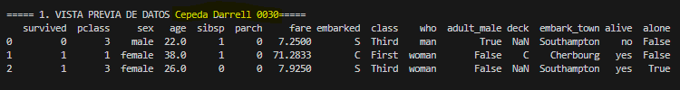
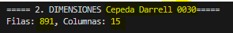
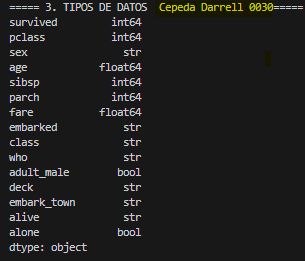
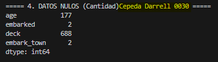
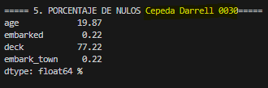
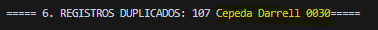
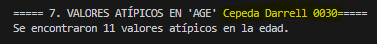
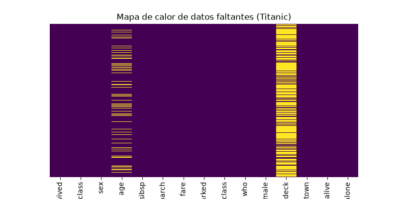

# 🕵️‍♂️ Práctica: Identificación de Problemas en los Datos

> **⏱️ Duración:** 2 horas  
> **🎯 Nivel:** Cero a principiante  
> **🤖 Área:** Machine Learning (Data Cleaning)  
> **💻 Herramientas:** Python, VS Code, Pandas, NumPy, Seaborn  

---

## 🎯 Propósito de la Práctica
Que los estudiantes aprendan a revisar conjuntos de datos (*datasets*) e identifiquen los problemas más comunes que pueden arruinar el entrenamiento de un modelo de Machine Learning.

## 🚢 3. Caso 1: Identificación de problemas (Titanic)

# Vista previa de datos

# Dimensiones

# Tipos de Datos

# Datos nulos (cantidad)

# Porcentaje de nulos

# Registros duplicados

# Valores Atipicos en 'AGE'

# Mapa de calor
